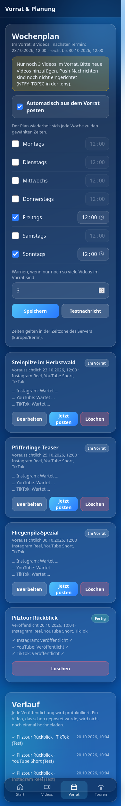

# TourPost

Handy-Web-App, um ein Video von unterwegs automatisch als Instagram Reel, YouTube Short und auf TikTok zu veröffentlichen. Das Smartphone ist die Fernbedienung, ein kleiner Node-Server übernimmt den Upload.

## Einrichtung & Nutzung

Du brauchst Linux oder macOS mit `git` und `curl` und ein Handy im selben WLAN. Node.js wird bei Bedarf automatisch installiert.

```bash
git clone https://github.com/R13N3K3/tourpost.git
cd tourpost
./setup.sh
npm start
```

1. `./setup.sh` richtet alles ein und zeigt einen **QR-Code** für diesen Rechner.
2. Mit der Handy-Kamera scannen. Die App öffnet sich im Browser.
3. Optional „Zum Startbildschirm hinzufügen", dann startet sie wie eine App.
4. Unter **Vorrat** den **Wochenplan** einstellen: Wochentage und Uhrzeit wählen, „Automatisch aus dem Vorrat posten" einschalten, speichern.
5. Unter **Video verteilen** Videos hochladen (Titel, Text, Hashtags, Plattformen) und **„In den Vorrat"** wählen.

Ab jetzt postet der Server selbstständig: Zu jedem Termin des Wochenplans nimmt er das **älteste** Video aus dem Vorrat und veröffentlicht es. Du musst nur dafür sorgen, dass der Vorrat nicht leer läuft.

Lädt die Seite nicht? Dann `./setup.sh --firewall` ausführen und prüfen, dass das Handy im selben WLAN ist (nicht Mobilfunk, kein Gast-WLAN). Weitere Optionen: `./setup.sh --service` startet den Server automatisch mit dem Rechner, `./setup.sh --tunnel` installiert `cloudflared` (nur für Instagram nötig, siehe unten).

### API-Schlüssel eintragen

Alle Zugangsdaten stehen in der Datei **`.env`** im Projektordner (`./setup.sh` legt sie aus `.env.example` an). Es gibt noch keine Eingabemaske in der App.

1. `.env` in einem Editor öffnen, zum Beispiel `nano .env`.
2. Die Werte hinter dem `=` eintragen, ohne Anführungszeichen und ohne Leerzeichen.
3. Speichern und den **Server neu starten** (`Strg+C`, dann `npm start`; beim Dienst `systemctl --user restart tourpost`). Die `.env` wird nur beim Start gelesen.

| Eintrag | Bedeutung |
|---|---|
| `IG_MODE` | `test` = es wird nichts gepostet (simuliert), `live` = echter Instagram-Upload |
| `IG_USER_ID` | Instagram-Konto-ID (Business- oder Creator-Konto) |
| `IG_ACCESS_TOKEN` | Instagram-Token aus der Meta-Developer-App (ca. 60 Tage gültig) |
| `PUBLIC_BASE_URL` | Öffentliche HTTPS-Adresse des **Medienservers** (Cloudflare Tunnel auf `MEDIA_PORT`). Instagram lädt das Video von dort ab |
| `MEDIA_PORT` | Port des Medienservers, Standard 3001 |
| `YT_MODE` | `test` oder `live` für YouTube |
| `YT_CLIENT_ID`, `YT_CLIENT_SECRET` | OAuth-Client aus der Google Cloud Console |
| `YT_REFRESH_TOKEN` | Wird von `npm run youtube-auth` eingetragen, nicht von Hand |
| `YT_PRIVACY` | `public`, `unlisted` oder `private` (zum Testen `private`) |
| `TT_MODE` | Bleibt auf `test`, TikTok ist noch nicht angebunden |
| `NTFY_TOPIC` | Optional: Thema für Push-Nachrichten aufs Handy (siehe „Benachrichtigungen") |

Zum Ausprobieren erst mit `IG_MODE=test` testen und erst dann auf `live` stellen. Die `.env` enthält Geheimnisse und ist per `.gitignore` vom Repository ausgeschlossen. Nie weitergeben oder committen.

### Wo bekomme ich die Schlüssel her, und wie teste ich?

> **Todo / ungeprüft:** Die Schritte unten stammen aus der Plattform-Dokumentation bzw. dem Kenntnisstand und sind noch nicht mit echten Konten durchgespielt. Menüs und Regeln der Plattformen ändern sich, im Zweifel die aktuelle Doku prüfen. Vorher überall `…_MODE=test` lassen.

**Instagram** (Code vorhanden, noch nie live getestet)
Läuft über die **Instagram API mit Instagram-Login**. Es wird **keine Facebook-Seite** gebraucht, das Konto muss nur **Creator oder Business** sein.
1. Auf [developers.facebook.com](https://developers.facebook.com) eine **App** anlegen (Typ „Business") und den Anwendungsfall **„Instagram API mit Instagram-Login"** hinzufügen. Die Menünamen ändern sich bei Meta öfter, im Zweifel danach suchen.
2. Das Instagram-Konto als **Instagram-Tester** der App hinzufügen und die Einladung in der Instagram-App annehmen (Einstellungen → Apps und Websites → Tester-Einladungen).
3. Im App-Dashboard bei der Instagram-Einrichtung für dieses Konto ein **Token generieren**, mit der Berechtigung `instagram_business_content_publish` (zusätzlich `instagram_business_basic`). Das ist `IG_ACCESS_TOKEN` und gilt ca. 60 Tage. Vor Ablauf verlängern oder neu erzeugen.
4. `IG_USER_ID` ist die Instagram-Konto-ID. Sie steht beim Token-Erzeugen im Dashboard oder kommt von: `curl "https://graph.instagram.com/v23.0/me?fields=user_id,username&access_token=<TOKEN>"` (Feld `user_id`).
5. `PUBLIC_BASE_URL`: Instagram holt das Video selbst von einer öffentlichen HTTPS-Adresse. Dafür läuft neben der App ein kleiner **Medienserver** (Port `MEDIA_PORT`, Standard 3001, nur lokal erreichbar), der ausschließlich `/media/<zufälliger-Dateiname>` ausliefert. **Nur diesen Port** durch einen Cloudflare Tunnel ins Internet stellen, nie die App (Port 3000). Der Tunnel braucht keine Portfreigabe im Router, weil er die Verbindung von deinem PC nach außen aufbaut.
   - Zum Testen ohne Konto: `cloudflared tunnel --url http://127.0.0.1:3001` (Installation mit `./setup.sh --tunnel`). Die ausgegebene `https://….trycloudflare.com`-Adresse als `PUBLIC_BASE_URL` in die `.env` eintragen und den Server neu starten. Die Adresse ändert sich bei jedem Start des Tunnels.
   - Für den Dauerbetrieb einen festen Tunnel mit kostenlosem Cloudflare-Konto und eigener Domain einrichten.
- **Testen:** (1) Adresse prüfen: `<PUBLIC_BASE_URL>/media/test` muss „404“ liefern (der Tunnel erreicht den Medienserver), die App selbst (`<PUBLIC_BASE_URL>/api/status`) darf von außen **nicht** erreichbar sein. (2) Token prüfen: der `curl` aus Schritt 4 muss `user_id` und `username` liefern. (3) `IG_MODE=live` setzen und **ein kurzes Wegwerf-Video** nur für Instagram posten (Hochformat 9:16, MP4, über 3 Sekunden), danach das Reel auf Instagram wieder löschen. Achtung: Die Duplikatsperre merkt sich dieses Video, es lässt sich nicht noch einmal hochladen.
- Solange die Meta-App im Entwicklermodus ist, funktioniert sie nur für Konten, die als Tester eingetragen sind. Das reicht hier, ein App-Review ist nicht nötig.

**YouTube** (Code vorhanden, noch nie live getestet)
1. In der [Google Cloud Console](https://console.cloud.google.com) ein **Projekt** anlegen und unter „APIs & Dienste" die **YouTube Data API v3** aktivieren.
2. **OAuth-Zustimmungsbildschirm** einrichten (extern, Name und E-Mail frei wählbar). Das eigene Google-Konto als **Testnutzer** eintragen. Der Testmodus lässt das Token nach 7 Tagen ablaufen, deshalb später auf „In Produktion" stellen.
3. Unter „Anmeldedaten" eine **OAuth-Client-ID** vom Typ **Desktop-App** erstellen. Client-ID und Client-Secret in die `.env` als `YT_CLIENT_ID` und `YT_CLIENT_SECRET` eintragen.
4. Auf dem PC `npm run youtube-auth` ausführen, den angezeigten Link im Browser öffnen und mit dem YouTube-Konto anmelden (bei „nicht verifiziert" auf „Erweitert" und „Weiter" klicken). Das Skript trägt `YT_REFRESH_TOKEN` selbst in die `.env` ein.
5. `YT_MODE=live` setzen, `YT_PRIVACY=private` zum Testen, Server neu starten.
- **Testen:** Ein Wegwerf-Video nur für YouTube hochladen („Sofort"). Im YouTube Studio prüfen, ob es da ist und als Short erkannt wird (hochkant, höchstens 3 Minuten). Danach löschen, die Duplikatsperre merkt sich das Video. Erst dann `YT_PRIVACY=public`.
- Uploads aus nicht geprüften API-Projekten setzt Google zunächst auf **privat**, auch bei `YT_PRIVACY=public`. Dafür gibt es ein Prüfformular von Google. Das Tageskontingent (10.000 Einheiten, ein Upload ca. 1.600) reicht für 1–2 Videos pro Woche.

**TikTok** (noch nicht angebunden)
- Auf [developers.tiktok.com](https://developers.tiktok.com) eine App anlegen, die Produkte **Login Kit** und **Content Posting API** hinzufügen. Daraus kommen Client Key und Client Secret, dazu ein Token über die Anmeldung im Browser.
- Ohne bestandenes **App-Audit** sind Direct-Post-Videos nur **privat** sichtbar. Als Alternative gibt es den **Upload als Entwurf**: Das Video landet im TikTok-Postfach und wird dort per Tipp veröffentlicht.
- **Testen:** Zuerst im **Sandbox-Modus** der App mit dem eigenen Testkonto, dann Entwurf-Upload, erst nach dem Audit Direct Post.

## Vorschau

<table>
  <tr>
    <td align="center"><b>Hauptmenü</b></td>
    <td align="center"><b>Video verteilen</b></td>
    <td align="center"><b>Vorrat &amp; Planung</b></td>
    <td align="center"><b>Pilztouren</b></td>
  </tr>
  <tr>
    <td></td>
    <td></td>
    <td></td>
    <td></td>
  </tr>
</table>

## So funktioniert's

- **Vorrat:** Hochgeladene Videos warten auf dem Server. Die Reihenfolge ist „ältestes zuerst". Die App zeigt zu jedem Video den voraussichtlichen Termin und wie lange der Vorrat reicht.
- **Wochenplan:** Pro Wochentag eine Uhrzeit (zum Beispiel Dienstag und Freitag um 12:00). Alle 10 Sekunden prüft der Server, ob ein Termin da ist, und veröffentlicht dann **ein** Video. Zeiten gelten in der Zeitzone des Servers. Verpasste Termine (Server war aus) holt er bis zu 12 Stunden später nach, ältere nicht.
- **Weitere Optionen beim Hochladen:** „Zu einem festen Zeitpunkt" für ein einzelnes Video und „Sofort (zum Testen)".
- **Veröffentlichen:** Instagram holt das Video über eine öffentliche URL ab und zeigt es als Reel (Instagram API). YouTube und TikTok bekommen die Datei direkt vom Server. Danach wird die Videodatei gelöscht.

### Benachrichtigungen

Der Server meldet sich per Push aufs Handy, wenn
- der Vorrat knapp wird (Schwelle einstellbar, Standard: 2 Videos oder weniger) oder leer ist,
- ein Termin ohne Video bleibt,
- eine Veröffentlichung fehlschlägt.

Eingerichtet wird das mit [ntfy](https://ntfy.sh), einer kostenlosen App für Android und iPhone:
1. ntfy-App installieren und ein **schwer erratbares Thema** abonnieren, zum Beispiel `tourpost-x7k2m9q4`.
2. Dasselbe Thema in die `.env` eintragen: `NTFY_TOPIC=tourpost-x7k2m9q4`, Server neu starten.
3. In der App unter „Vorrat" auf „Testnachricht" tippen.

Wer das Thema kennt, kann mitlesen. Die Nachrichten enthalten Videotitel. Für mehr Privatsphäre gibt es einen eigenen ntfy-Server (`NTFY_SERVER`). Ohne `NTFY_TOPIC` zeigt die App die Warnung nur auf der Vorrat-Seite an.

**Kein doppeltes Posten**
- Jede Veröffentlichung wird dauerhaft in `data/log.jsonl` protokolliert (Zeit, Titel, Plattform, Ergebnis). Das Protokoll bleibt auch erhalten, wenn ein Video aus dem Vorrat gelöscht wird.
- Jedes Video bekommt beim Upload einen Fingerabdruck (SHA-256 des Inhalts). Ein bereits veröffentlichtes oder schon im Vorrat liegendes Video wird abgelehnt, auch wenn es umbenannt wurde.
- Klappt eine Plattform nicht, werden beim erneuten Versuch nur die fehlgeschlagenen Plattformen wiederholt. Bereits veröffentlichte werden übersprungen.
- Wird der Server mitten in einer Veröffentlichung beendet, wiederholt er sie nicht automatisch, sondern markiert sie als „Unterbrochen". Du prüfst dann selbst, ob das Video schon online ist.
- Verpasste Termine (Server war aus) werden beim nächsten Start nachgeholt.
- Testläufe (`IG_MODE=test` usw.) zählen für die Sperre nicht, damit du beim Ausprobieren dasselbe Video mehrfach nutzen kannst.

Die geheimen Zugangsdaten liegen nur auf dem Server (`.env`), nie in der App.

## Projektstruktur

```
setup.sh  Einrichtung auf einem neuen Rechner
public/   App (HTML, CSS, JS, PWA) – Hauptmenü, Video-Seite, Pilztouren-Platzhalter
server/   Express-Server mit Planer und Wochenplan (schedule.js, settings.js), Vorrat (queue.js), Protokoll (log.js),
          Benachrichtigung (notify.js), Medienserver (media.js, liefert nur Videodateien für den Tunnel aus) und ein Modul pro Plattform (instagram.js, youtube.js, tiktok.js)
data/     Vorrat, Wochenplan und Protokoll (queue.json, settings.json, log.jsonl), nicht im Repo
scripts/  Hilfsskripte (QR-Code, YouTube-Anmeldung)
docs/     Screenshots für die README
```

Neue Unterseiten werden in `public/js/nav.js` eingetragen, neue Plattformen als Modul in `server/`.

## Konfiguration (`.env`)

| Variable | Bedeutung |
|---|---|
| `IG_MODE` | Instagram: `test` simuliert nur, `live` postet wirklich |
| `YT_MODE` | YouTube: `test` oder `live` (Live ungetestet, siehe oben) |
| `TT_MODE` | TikTok: `test` oder `live` (Live noch nicht eingerichtet) |
| `IG_USER_ID` | Instagram-Business-/Creator-User-ID |
| `IG_ACCESS_TOKEN` | langlebiges Meta-Access-Token |
| `PUBLIC_BASE_URL` | öffentliche HTTPS-Adresse des Servers (z. B. Cloudflare Tunnel) |
| `NTFY_TOPIC` | ntfy-Thema für Push-Nachrichten (leer = aus) |
| `NTFY_SERVER` | eigener ntfy-Server, Standard `https://ntfy.sh` |
| `PORT` | Port, Standard 3000 |

Für den Live-Modus braucht es ein Instagram-Business- oder Creator-Konto, eine Meta-Developer-App und eine öffentlich erreichbare HTTPS-URL, damit Instagram das Video abholen kann. Die `.env` gehört nie ins Repo (steht in der `.gitignore`).

## Status

Prototyp. Alle drei Plattformen laufen im Testmodus (Upload, Vorrat, Wochenplan mit Autopilot, Status pro Plattform, Protokoll, Duplikatschutz, Warnungen). Live sind Instagram und YouTube programmiert, aber noch nicht mit echten Konten getestet (YouTube nur gegen eine Attrappe der Schnittstelle). TikTok (Login, App-Prüfung) ist noch nicht angebunden. Es gibt noch keinen Zugangsschutz – den Server nicht ungeschützt ins Internet stellen.

## Geplant

- Instagram und YouTube live testen, danach TikTok anbinden
- Videoprüfung vor dem Upload (Format, Länge, Seitenverhältnis)
- Zugangsschutz
- Kundenansicht für gebuchte Pilztouren
