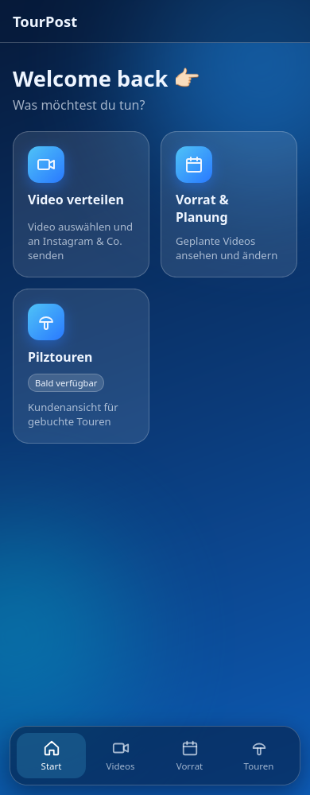
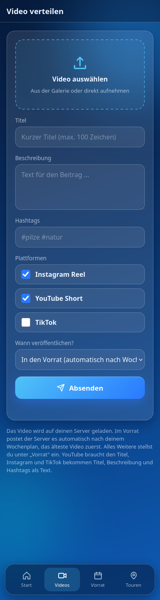
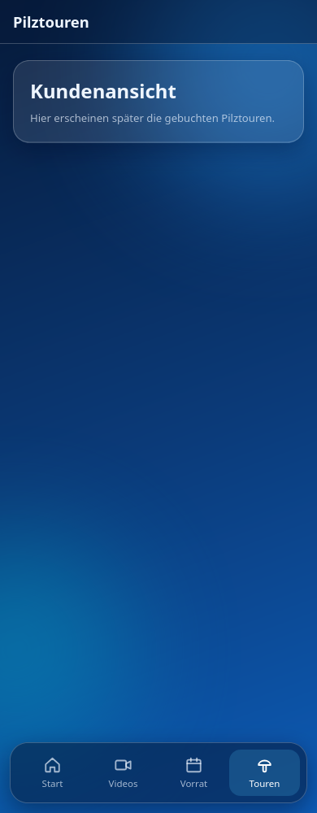

# TourPost

Handy-Web-App, um ein Video von unterwegs automatisch auf Instagram (später YouTube, TikTok) zu veröffentlichen. Das Smartphone ist die Fernbedienung, ein kleiner Node-Server übernimmt den Upload.

## Einrichtung

**Voraussetzungen:** Linux oder macOS, Node.js ab Version 18 und ein Handy im selben WLAN wie der Rechner.

```bash
git clone https://github.com/R13N3K3/tourpost.git
cd tourpost
./setup.sh
npm start
```

Das Skript `setup.sh` erledigt alles Nötige: Es prüft Node, installiert die Abhängigkeiten, legt `uploads/` und eine `.env` an (im Testmodus, es wird nichts gepostet) und zeigt am Ende die Adresse und einen QR-Code an. Es ist gefahrlos mehrfach ausführbar und überschreibt eine vorhandene `.env` nie.

**Optionen**

| Aufruf | Wirkung |
|---|---|
| `./setup.sh --firewall` | gibt den Port per `ufw` für dein Heimnetz frei (sonst blockiert die Firewall das Handy) |
| `./setup.sh --service` | richtet einen systemd-Dienst ein, der Server startet dann automatisch |
| `./setup.sh --firewall --service` | beides |

Für einen QR-Code im Terminal ist `qrencode` nötig (`sudo pacman -S qrencode` / `sudo apt install qrencode`). Ohne ihn läuft das Skript trotzdem.

## Nutzung

1. Server läuft (`npm start` oder als Dienst).
2. Auf dem Handy die vom Skript angezeigte Adresse öffnen, zum Beispiel `http://192.168.88.243:3000`, oder den QR-Code scannen.
3. Im Browser „Zum Startbildschirm hinzufügen" wählen, dann startet die App wie eine normale App.
4. „Video verteilen" öffnen, Video wählen, Beschreibung und Hashtags eintragen, „Absenden".

Der Server lädt das Video hoch, Instagram holt es ab und veröffentlicht es als Reel. Im Testmodus wird das nur simuliert.

**Wenn die Seite nicht lädt:** Handy im gleichen WLAN (nicht Mobilfunk, kein Gast-WLAN)? Firewall offen (`./setup.sh --firewall`)? Adresse mit `http://` statt `https://`?

## Vorschau

<table>
  <tr>
    <td align="center"><b>Hauptmenü</b></td>
    <td align="center"><b>Video verteilen</b></td>
    <td align="center"><b>Pilztouren</b></td>
  </tr>
  <tr>
    <td></td>
    <td></td>
    <td></td>
  </tr>
</table>

## Schnellzugriff im Heimnetz


`http://192.168.88.243:3000` – gilt nur im Heimnetz des Entwicklers. Auf einem anderen Rechner zeigt `./setup.sh` den passenden QR-Code. Neu erzeugen: `qrencode -s 10 -m 2 -o docs/qr-lokal.png "http://<IP>:3000"`.

## So funktioniert's

1. Video in der App wählen, Beschreibung und Hashtags eintragen, „Absenden".
2. Der Server stellt das Video kurz unter einer öffentlichen URL bereit.
3. Instagram holt es ab und veröffentlicht es als Reel (Graph API), danach wird das Video gelöscht.

Die geheimen Zugangsdaten liegen nur auf dem Server (`.env`), nie in der App.

## Projektstruktur

```
setup.sh  Einrichtung auf einem neuen Rechner
public/   App (HTML, CSS, JS, PWA) – Hauptmenü, Video-Seite, Pilztouren-Platzhalter
server/   Express-Server + Plattform-Module (instagram.js)
docs/     Screenshots und QR-Code für die README
```

Neue Unterseiten werden in `public/js/nav.js` eingetragen, neue Plattformen als Modul in `server/`.

## Konfiguration (`.env`)

| Variable | Bedeutung |
|---|---|
| `IG_MODE` | `test` simuliert nur, `live` postet wirklich |
| `IG_USER_ID` | Instagram-Business-/Creator-User-ID |
| `IG_ACCESS_TOKEN` | langlebiges Meta-Access-Token |
| `PUBLIC_BASE_URL` | öffentliche HTTPS-Adresse des Servers (z. B. Cloudflare Tunnel) |
| `PORT` | Port, Standard 3000 |

Für den Live-Modus braucht es ein Instagram-Business- oder Creator-Konto, eine Meta-Developer-App und eine öffentlich erreichbare HTTPS-URL, damit Instagram das Video abholen kann. Die `.env` gehört nie ins Repo (steht in der `.gitignore`).

## Status

Prototyp. Testmodus läuft, der Live-Upload ist noch nicht mit einem echten Konto getestet. Es gibt noch keinen Zugangsschutz – den Server nicht ungeschützt ins Internet stellen.

## Geplant

- Zugangsschutz
- Videos im Voraus hochladen und planen
- YouTube und TikTok
- Kundenansicht für gebuchte Pilztouren
